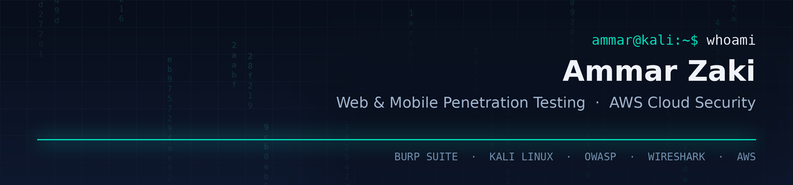

<p align="center">
  
</p>

<p align="center">
  
</p>

<p align="center">
  <a href="https://www.linkedin.com/in/ammar-zaki-59043b23a"></a>
</p>

---

### `$ whoami`

```yaml
name:     Ammar Zaki
studying: BSc Computer Science @ The British University in Egypt (2027)
focus:    [web app pentesting, mobile pentesting, cloud security]
now:      pentesting internship + phishing-detection graduation project
motto:    "I'd rather break it in a lab and fix it than only read about it."
```

### `$ ls ./arsenal`

<p>
  
  
  
  
  
  
  
</p>
<p>
  
  
  
  
  
</p>

### `$ cat certs.txt`

```text
[✓] Cisco      Introduction to Cybersecurity
[✓] AWS Academy  Cloud Foundations · Cloud Security Foundations · Cloud Operations · ML Foundations
[~] AWS Academy  Cloud Architecting (in progress)
```

### `$ ./now_working_on.sh`

```text
> Graduation project: a phishing detector built to hold up against AI-written emails
> Write-ups for my OWASP Juice Shop labs
> More projects landing here soon
```

---

<p align="center">
  <sub><code>ammar@kali:~$ exit</code></sub>
</p>
